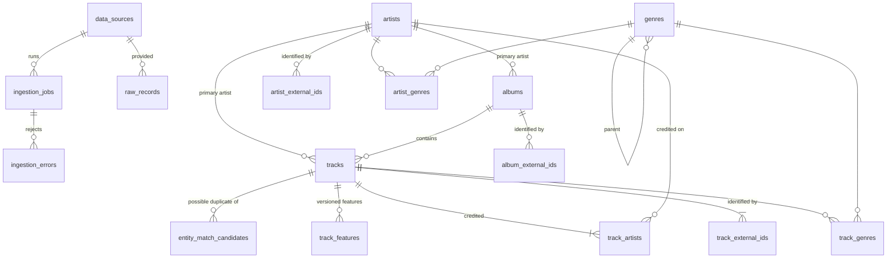

# TASTIFY — Database Design

> Derived from the approved specification [TASTIFY_v0.1.md](../TASTIFY_v0.1.md) (§6.2–6.5).
> This file is the maintained version: update it in the same pull request as the code it describes.

### 6.2 Main Domain Entities

#### User

Attributes:
- id
- email
- password_hash (only for local authentication)
- status
- created_at
- updated_at

#### UserPreference

Attributes:
- id
- user_id
- preferred_genres
- preferred_artists
- preferred_languages
- preferred_moods
- exploration_level
- excluded_artists

#### Track

Attributes:
- id
- title
- duration_ms
- release_date
- artist_id
- album_id
- isrc
- metadata_source
- created_at

#### Artist

Attributes:
- id
- name
- external_identifiers
- metadata

#### TrackFeatures

Attributes:
- track_id
- tempo
- energy
- danceability
- valence
- acousticness
- instrumentalness
- feature_source
- feature_version

Features are optional and must only be populated from permitted sources or our own models.

#### UserInteraction

Attributes:
- id
- user_id
- track_id
- event_type
- event_timestamp
- session_id
- source
- metadata

#### Playlist

Attributes:
- id
- user_id
- name
- category
- description
- created_at
- updated_at

#### PlaylistTrack

Attributes:
- playlist_id
- track_id
- position
- added_at

#### RecommendationLog

Attributes:
- id
- user_id
- track_id
- recommendation_category
- ranking_score
- model_version
- request_id
- created_at

### 6.3 Database Relationships

- User 1:N UserPreference (or one active preference record).
- User 1:N UserInteraction.
- User 1:N Playlist.
- User N:M Track through UserInteraction.
- Artist 1:N Track.
- Track 1:N TrackFeatures versions.
- Playlist N:M Track through PlaylistTrack.
- User 1:N RecommendationLog.

### 6.4 Database Design Rules

1. Use UUID primary keys.
2. Enforce foreign key constraints.
3. Add indexes to frequently queried fields.
4. Use unique constraints for provider identifiers.
5. Use database migrations.
6. Store timestamps in UTC.
7. Preserve immutable interaction events.
8. Separate raw events from aggregated features.
9. Avoid storing duplicate provider metadata unnecessarily.
10. Use JSONB only for genuinely variable metadata, not as a substitute for relational modelling.

### 6.5 Required Indexes

- users(email)
- tracks(isrc)
- tracks(artist_id)
- artists(name)
- user_interactions(user_id, event_timestamp)
- user_interactions(track_id, event_type)
- playlists(user_id, created_at)
- playlist_tracks(playlist_id, position)
- recommendation_logs(user_id, created_at)

Use composite indexes based on actual query plans after profiling.

---

## Implemented catalogue schema (Milestone 1)

ORM models: `backend/app/domains/catalogue/models.py`. Migration: `65ea8b207eac`.

| Table | Purpose and key rules |
| --- | --- |
| `data_sources` | One row per external source, with licence and `usage_restriction` (`none`, `non_commercial`, `research_only`). Referenced by every record below. |
| `ingestion_jobs` / `ingestion_errors` | One job per pipeline stage run (parameters, statistics, status). Errors are sampled at up to 200 per code per job. |
| `raw_records` | API payloads exactly as received (JSONB + SHA-256), unique per (source, entity type, external id). |
| `artists`, `albums`, `tracks` | Canonical entities. `normalized_name`/`normalized_title` carry trigram (GIN) indexes for search. `tracks.matching_key` (artist \| cleaned title) is indexed for candidate lookup. `tracks.isrc` holds the primary ISRC. Albums are works (MusicBrainz release groups), not editions. |
| `track_artists` | Full ordered credit ("A feat. B"). Position 0 is the primary artist. |
| `track_external_ids`, `artist_external_ids`, `album_external_ids` | Provider identifiers, **unique per (provider, external_id)**. `match_method` (`source`, `isrc`, `metadata`, `track_link`) and `confidence` explain each link. ISRCs are stored here with provider `isrc`. |
| `genres` | MusicBrainz genre vocabulary plus FMA genres, with an optional parent (FMA hierarchy). |
| `track_genres`, `artist_genres` | Genre votes normalized to weights that sum to 1 per (track, source, level). `level` is `recording` or `album`. |
| `track_features` | Audio features per (track, feature_source, feature_version). Unit-scale columns are CHECK-constrained to [0, 1]. |
| `entity_match_candidates` | Possible duplicates awaiting review (`pending`, `accepted`, `rejected`), with JSONB evidence signals. |

Design notes:

- Text enums are `CHECK` constraints rather than PostgreSQL enum types, so adding a value is a
  plain migration.
- JSONB is used only for raw payloads, job parameters/statistics and match evidence, which are
  genuinely variable (rule 10).
- Listening events from ListenBrainz are research data and are **not** stored here (see
  DATA_SOURCES.md, Privacy). `users` and `user_interactions` arrive with Milestone 4.

---

## Migrations workflow

Implemented in Milestone 0. Alembic runs on the async SQLAlchemy engine. The configuration lives in
`backend/alembic.ini`, and `backend/alembic/env.py` reads `DATABASE_URL` from the application
settings, so credentials never appear in `alembic.ini`.

Constraint names follow the naming convention in `backend/app/core/database.py`, so autogenerated
migrations stay deterministic. Revision files are named `YYYYMMDD_HHMM_<revision>_<slug>.py` and are
linted and formatted with ruff automatically when generated.

### Adding a schema change

1. Add or change models in `app/domains/<domain>/models.py` (inheriting from `app.core.database.Base`),
   and make sure the module is imported in `alembic/env.py`.
2. Generate a revision: `alembic revision --autogenerate -m "add users table"`.
3. **Review it by hand.** Autogenerate does not detect everything: extensions, renames (they appear as
   drop + add), some server-default and enum changes, and data migrations all need manual edits.
4. Verify both directions: `alembic upgrade head && alembic downgrade -1 && alembic upgrade head`.
5. Commit the model change and its migration in the same pull request.

### Rules

- Never edit a migration that has been merged to `main`. Write a new one instead.
- Every migration implements `downgrade()`. If a change is truly irreversible, raise with an explanation.
- Migrations must not import application models; they describe the schema as it was at that revision.
- CI applies all migrations to an empty database, rolls them back to base, re-applies them, and runs
  `alembic check` to fail on any drift between models and migrations.

### Revisions

| Revision       | Description                                                                                                  |
| -------------- | ------------------------------------------------------------------------------------------------------------ |
| `3f6c2a9d1b0e` | Enable the `vector` extension (pgvector). Needs a superuser, or the extension pre-installed on managed PostgreSQL. |
| `65ea8b207eac` | Catalogue schema (Milestone 1): provenance, canonical tracks/artists/albums, external ids, genres, features, match review; enables `pg_trgm`. |

### Databases

| Database       | Used by                                     | Created by                                                      |
| -------------- | ------------------------------------------- | --------------------------------------------------------------- |
| `tastify`      | Local development                           | `POSTGRES_DB` in docker compose                                 |
| `tastify_test` | Integration tests (`pytest -m integration`) | `infrastructure/docker/postgres/init/` (in CI: the service container) |
